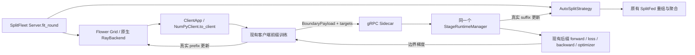

# Virtual SFL Runtime

本入口用当前锁定版本的 Flower `ClientApp`、`ServerAppComponents(server=...)` 和原生 RayBackend 调度虚拟客户端。训练调用现有 `AutoSplitSplitLearningClient`、`AutoSplitTailServerModel` 和 `AutoSplitStrategy`；前缀、后缀、边界梯度和 SplitFed 聚合都真实执行。

物理训练仍从 `experiments.physical_multitask` 进入。Greedy 策略的成本预测仍只用于决策，不是本入口的训练结果。

## 安装与运行

```bash
uv sync --extra simulation --extra dev --extra integration

# 不依赖数据下载的两客户端、两轮 CPU 正确性运行
uv run --extra simulation python -m experiments.virtual_sfl run \
  --config experiments/virtual_sfl/configs/smoke.yaml \
  --output results/virtual_sfl/my_smoke

# 全部 100 个客户端参与两轮 ResNet-18 / CIFAR-10 真实训练
uv run --extra simulation --extra experiment python -m experiments.virtual_sfl run \
  --config experiments/virtual_sfl/configs/clients100.yaml \
  --output results/virtual_sfl/my_real100

# 四任务真实模型、真实数据
uv run --extra simulation --extra integration python -m experiments.virtual_sfl run \
  --config experiments/virtual_sfl/configs/multitask.yaml \
  --output results/virtual_sfl/my_multitask
```

输出目录必须是新的。CLI 使用项目已有 `begin_run` / `freeze_runtime` / `claim_frozen_run`，从保存的 `runtime_snapshot` 子进程执行，保留源码与依赖哈希、配置、一次性尝试标记和 `stdout.log`。失败或中断的目录也不能复用。Python API 会冻结源码作为证据；调用者定义的外部模型/数据工厂还需自行冻结其来源。

运行入口直接使用当前 Flower Simulation Runtime 的 `run_simulation(server_app, client_app, num_supernodes, backend_config=...)`。旧的 `start_simulation` 和旧版兼容分支已删除；缺少 Ray 时会明确要求安装 `simulation`，不会切换成成本模拟。

| 配置 | 内容 |
|---|---|
| `smoke.yaml` | 2 客户端、显式 1 Worker 排队测试、2 轮、真实梯度正确性 fixture |
| `concurrent16.yaml` | 16 客户端、16 Worker、全部参与、2 轮 |
| `clients100.yaml` | 100 客户端、100 Worker、200 个真实优化步骤、CIFAR-10 |
| `network.yaml` | Greedy、上传/下载限速、RTT、第二轮改变条件 |
| `dynamic_server.yaml` | Greedy、服务器执行槽按轮次 1 → 2 → 1 |
| `comparison.yaml` | 同初始化、同分区的静态切点与正式 Greedy |
| `failures.yaml` | 不均衡数据、CPU 亲和性、掉线、执行一批后退出及恢复 |
| `multitask.yaml` | ResNet-18、BERT-base、RF-DETR Nano、DeepLabV3-ResNet50 |
| `gpu.yaml` | 小模型 CUDA 前缀 / CPU 后缀，GPU fraction 只作调度配额 |
| `multinode.yaml` | 需替换地址和 PEM 路径的受保护 Ray 集群配置 |

fixture 用于执行正确性测试，结果明确标记 `data_source: fixture`。正式数据配置标记 `real`，不会自动下载或替换数据。CIFAR-10、AG News CSV、VOC 2007、Oxford-IIIT Pet 复用现有数据接口。BERT 使用固定 revision 的配置和 tokenizer；也可设置 `workload.tokenizer_path`。这些配置验证的是训练运行时，未声称达到收敛质量或加载完整预训练权重。

收敛实验可显式设置 `workload.pretrain_weights` 为所有 Worker 可访问的本地检查点。模型工厂加载该检查点，运行记录保留其路径和 SHA-256；不设置时使用随机初始化，即使模型名包含 `pretrained`。ResNet50 的边缘模型预设冻结 BatchNorm 统计，微调时应提供相应预训练权重。设置 `workload.require_complete_round: true` 后，任何客户端失败或缺失都会在聚合前终止实验，失败原因仍保留在客户端记录中。

长实验设置 `workload.checkpoint_each_round: true`，在每个成功轮次聚合后将完整全局模型保存到 `checkpoints/round_NNNN.pt`（其他后端为 `.npz`）。每轮检查点包含模型哈希和当轮 Greedy 状态副本；`latest_checkpoint.json` 在模型写完后原子更新。它保存轮末全局模型，优化器仍按原语义每轮重建。评估结果另逐轮写入 `evaluation_metrics.jsonl`。CLI 检测到子进程异常退出时，会将遗留的 `running` 状态改为 `failed`，并保留已完成轮次的指标。

图像分类可设置 `workload.training_method: fedavg`，使用原生 Flower FedAvg 和完整模型训练；默认值为 `splitfleet`。两者复用模型、数据分区、batch 顺序、SGD、评估和逐轮检查点。FedAvg 在配置的客户端设备上训练完整模型；SplitFleet 在相同客户端设备上训练前缀，并在服务器设备上训练后缀。

配对比较在同一 YAML 的 `runs.splitfleet` 与 `runs.fedavg` 中提供两份配置，仅 `workload.training_method` 不同。CLI 按配置顺序逐个执行，不并行争抢同一机器。全部完成后，核验初始化权重、数据内容、分区、源码和其他配置一致，自动输出 `convergence_comparison.csv`、`training_time_comparison.csv` 和 `comparison_summary.json`。时间取每个冻结子进程的实测执行时间，包含初始化、数据校验、校准、训练、评估、逐轮保存和清理，不含排队等待。每轮评估的累计时钟另从运行时证据初始化开始记录。

## 实际调用链



`VirtualServer.fit_round()` 调用原始 `Server.fit_round()`，保留 `configure_fit → configure_server_fit → initialize_server_models → fit_clients → collect_server_fit_results → aggregate_fit → aggregate_server_fit → finalize_round` 的顺序。外围只处理生命周期和遥测。

Sidecar 的 manager 就是联邦服务器的 manager。默认 SplitFed 为每个执行任务租用独立后缀模型，所有副本共享同一个有界执行池。共享的是计算资源；训练参数所有权仍独立。graph、plan、split、feature ABI、模型版本、状态所有权和步身份检查继续由原实现执行；虚拟桥额外核验 node/partition/轮次身份和当前完整模型哈希。

## 状态、排队与失败

`Context.node_config["partition-id"]` 决定稳定的 `virtual-N` 身份；本次运行中 `Context.node_id` 决定 RPC 路由。服务器验证二者一一对应，不依赖 Flower 随机 node ID 的排序决定分区。

每个消息重建客户端执行对象。`Context.state` 只保存身份、分区哈希、完成轮次/批次数、上次切点和序列化 RNG；不保存完整模型、优化器或计算图。当前全局参数由服务器下发并校验哈希。优化器每轮重建，保持物理客户端语义。Python、NumPy、Torch RNG 与线程/CPU 亲和性在 Worker 复用时恢复。数据抽样使用独立的 `(seed, partition, round, epoch)` generator，不依赖执行顺序。

默认原生 Ray 池的目标 Worker 数是单轮最大参与数，并按实际 CPU/GPU、线程和后缀内存准入下界收缩；逻辑客户端数只决定 Flower 注册和数据分区。`worker_count_policy: fixed` 或 `fixed_hardware` 是严格物理容量合同，Ray 启动容量不一致时 fail-closed。服务器可以同时提交全部客户端的 Flower 消息；`process_clients_as_batch=False`，独立请求不会等待整轮客户端一起到达。批次级后缀执行槽绑定有效 Worker 容量，由 semaphore 和线程池限流。

本地 Ray 节点的 CPU 总量必须是整数；内存降容后同步调整节点总量与单 Worker 预留，保持原生池大小符合准入结果。已有或远程 Ray 池若超过准入上限，会在训练开始前报错，不能仅截断记录中的 Worker 数。非严格策略仍可接受较小的原生池。

`acquire → train_tail → commit/abort` 租约保护每个任务。已尝试的同轮任务不能再次 acquire；已有的 split step 防重机制也保留。失败客户端的整个更新被丢弃，不能重试已经更新了一半的模型。下一轮恢复时加载最新全局参数。RPC 有真实 deadline；取消时先等正在使用模型的计算结束，再释放副本。训练 deadline 从 Worker 内 fit 开始，Worker 排队不会被当成掉队。长期 CPU/CUDA 调用不能安全地在 Python 内强制中断，deadline 会在批次边界或 RPC/任务检查处生效。

计划离线、未被选中、执行成功、失败和超时分别记录。随机故障按 seed 可复现；故障注入可以在已执行一批后退出。意外 OOM、协议错误或不匹配更新会使最终验证失败，不能以不完整结果标记成功。

## 内存与资源

`max_suffix_replicas` 描述逻辑后缀模型状态；物理后缀执行槽由 server_concurrency 控制，默认 1；显式设为 null 时绑定有效 Worker 容量。任务开始时按需创建副本，完成或失败后释放模型/优化器/克隆句柄；不会在 round 初始化时为所有逻辑客户端构造 native 模型。正在执行的副本不会驱逐。完成更新通过 `RoundStateStore` 暂存到磁盘，原有 owned-state 聚合现在可以逐个读取更新，只保留逻辑模型累加器和单个更新。Greedy 每轮结束释放已准备的执行视图，完整候选目录和私有成本表继续保留。

`server_memory_budget_mb` 用于状态/梯度/优化器大小的准入下界检查，CUDA 还检查当前可用显存。它不是 cgroup/RSS 的硬上限，也不能保证任意自定义模型的激活峰值。运行结果分别给出估计下界和真实进程 RSS / GPU allocated 峰值。`client_peak_memory_mb` 是 Worker 进程的高水位，可能包括早先消息和框架导入；不能解释为该客户端独占的内存。

`resources.mode: scheduling` 使用当前 Flower/Ray CPU/GPU 配额控制并发，不宣称这些配额限制计算速度。原生 RayBackend 使用统一 Worker 配额，因此每个 profile 的 `gpu_fraction` 必须与池配额一致。不同 profile 可选 CPU/CUDA 设备；CPU profile 可以在 `emulation` 模式下施加不同的 Linux CPU affinity 与 Torch 线程数，应用于训练 Worker 的现有线程，并在退出时恢复。CPU 核可以重叠分配，不保证独占。GPU fraction 不能用来模拟 GPU 性能上限。

Worker 导入框架前，原生线程池默认按 profile 的最大线程数初始化，避免进程复用时反复恢复主机规模的线程池。显式设置的 OpenMP、BLAS 和 TensorFlow 线程环境变量继续生效；这些设置不代表 CPU 算力硬限制。

Torch 后缀使用独立的 CPU/CUDA replica-local RNG，初始种子由实验 seed、稳定分区和轮次派生，不依赖 Flower 随机 node ID 或物理槽位。只有种子相同时才恢复保存的副本 RNG 状态。标准 Dropout、RReLU、randint 的不同重载、randperm、multinomial 等通过线程局部 ATen dispatch 使用该副本生成器；显式 generator 保持其原有行为，不能隔离的带随机性标记算子会明确报错。多槽配置不会用全局锁静默串行化；自定义直接修改全局 RNG 的 Python 代码仍需自行隔离。Ray 的资源配额只用于 Worker 调度，不宣称是实际算力或显存硬上限。

## 网络与 Greedy

`Network(upload_mbps, download_mbps, rtt_ms)` 复用 `experiments.tcp_pacing`，在每个客户端实际 TCP 流上作分方向限速及流水线传播延迟。有带宽上限的方向按带宽与单向延迟的乘积，加四个 16 KiB 块限制在途缓冲；没有带宽上限的方向不设置额外队列吞吐限制，其在途缓冲取决于真实发送速率与传播延迟。两种模式都会在接收端写入阻塞时停止读入。边界、梯度和模型状态都走这条路径。受限模式的 Flower FitIns/回复只携带联邦控制及指标，真实参数经同一 gRPC 通道同步，由 Grid proxy 恢复后交给原聚合逻辑。计数包含实际 TCP application stream / gRPC framing；不是 NIC 字节计数。TLS 模式下代理只转发密文。`packet_loss` 明确 unsupported，不会用删掉应用字节的方式冒充丢包。

配置中的带宽/RTT 是 `emulated` 条件，RPC 时间和实际传输字节是 `measured`。Greedy 成本预测、内存准入下界是 `estimated`。训练指标不使用预测值补缺测数据。

默认使用 `GreedyPlacementPolicy`、完整 TorchLens 候选目录和保持训练状态的校准。每轮选点前，各客户端在实际 split RPC 通道上主动测速：小包测应用层 RTT，分别增大请求和回复估计上下行有效吞吐，三次采样取中位数。策略只读取本轮探测记录，不读取限速配置。各客户端独立选择整轮预测成本最低的切点；实际训练反馈继续更新私有成本表。默认 server_concurrency=1，显式配置可调整同 GPU 后缀执行容量。真实服务器占用用于诊断，不进入 Greedy 的评分项。

运行时分别记录 Worker 容量、后缀执行上限、活动请求和排队时间。Greedy 不预测客户端联合到达序列，也不将冷准备成本作为单独的全局优化项；`switch_ms` 保留为切点变化时的实际准备观测。

Flower 的 bootstrap echo 校准属于联邦消息路径；每轮主动测速另走经过同一 TCP 限速机制的 split RPC 通道，测速不构建模型、不占训练租约。`placement_trace.jsonl` 保留原始样本、测速耗时及实际传输字节，测速开销计入完整用时。无效或过期的测量会中止本轮选点，不会用配置值补齐。实际训练 RPC 反馈继续更新私有成本表。`greedy_state.json` 与 `final_model.pt` 分开保存；恢复状态后仍重新测速。不强制算法在某轮改变切点。

两种等待分别记录：

- `virtual_worker_queue_sec`：同一 OS 时钟域内，从提交 Flower fit 到 ClientApp 进入；包含 Flower 交付与 Ray 排队，不是精确的 Ray 内部 enqueue-only 时间。
- `suffix_server_queue_sec`：Worker 已运行时，后缀批次等待真实执行槽的时间。后缀副本租约等待和准备时间另列。

跨主机时钟不可比较时，Worker 排队和一方向网络时间留空；RPC roundtrip/服务 duration 仍由持续时间计算。`round_wall_sec` 覆盖配置、身份握手、校准、训练及聚合；配置耗时另列，集中评估的时间和 loss/任务指标在 `model_metrics.json` 单列。并发重叠只在可比较时钟域内测量；失败任务的精确全局重叠峰值留空。

## 多节点

修改 `multinode.yaml` 的私网地址及证书路径。推荐专用 Ray cluster：head `ray start --head --port=6379 --num-cpus=0`，Worker 节点的 CPU/GPU 总资源必须足以容纳配置声明的每客户端 Worker 数；当前示例为 16 个逻辑客户端和 16 个 Worker。不同 GPU 配额还需要满足原生池的 GPU 资源条件。

所有节点安装相同锁定依赖；数据和 client CA/cert/key 应在配置指定的只读路径可访问。Ray `runtime_env.working_dir` 分发冻结源码。suffix `bind_host` 必须让 Worker 可达，`advertise_host` 必须匹配服务端证书 SAN。远程 sidecar 强制 mutual TLS，并使用每轮每客户端 token；不能把无认证接口默认绑定公网。Ray control plane 应在可信私网中部署。

执行仍使用同一 CLI。`validation.json.multi_node` 只有在实际收到多个 Worker 主机的成功训练结果时才能报告验证；本次交付没有可用的多机 Ray cluster，标记 `not_executed`。仅加载该示例配置不会成为测试成功证据。

## Python API 与验证

`splitfleet.virtual.TrainingSpec` 接受现有 `TaskSpec`、model factory、lazy dataset factory、collate、batch_axes、分类分区 labels 和可选 native evaluator。工厂必须可被 Ray 序列化。通过它可以复用已有实例分割 adapter；本次未增加实例分割的数据/模型 preset，也未验证该任务的虚拟真实数据实验。当前 ResNet50 配对入口固定 PyTorch、50 个虚拟客户端、100 轮，比较 SplitFleet 与 FedAvg 的收敛和实测用时。

```bash
uv run --extra simulation --extra dev --extra integration pytest tests/virtual
uv run --extra simulation --extra dev --extra integration pytest tests -m 'not simulation'
```

测试包含完整 SGD 数值对照（`rtol=1e-6, atol=1e-7`）、Context/RNG/数据隔离、16/100 客户端真实优化、原生 Greedy 反馈、真实 TCP 限速下界、租约防重、身份认证、RPC 超时、端口占用和 CPU affinity 恢复。所有输出都保留当前源码/依赖版本；缺少某个可选后端而被现有测试跳过的项不计作通过。

当前 PyTorch ResNet50 / 50 客户端 / 100 轮收敛与用时对比见 [实验入口说明](../resnet50_quality/README.md)。旧实验结果和历史运行报告已删除。

Flower 接口依据：当前锁定安装源码与端到端执行，以及官方 Simulation API 和 stateful ClientApp 文档。
